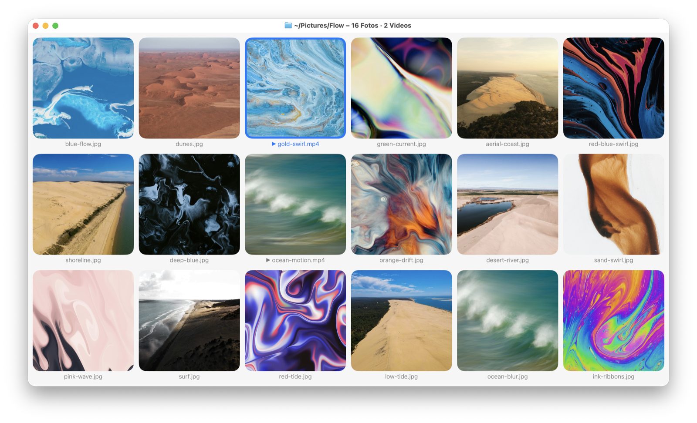

<p align="center"></p>

<h1 align="center">Flow</h1>

<p align="center">A tiny, fast photo and video viewer for macOS.<br>Point it at a folder and it shows every photo and video in a square grid, newest first. That's it.</p>



- **Fast:** thumbnails are cached on disk and generated in the background for the whole folder. Until a thumbnail is ready, Flow shows the preview embedded in the camera file, which loads quickly even from a network share.
- **Videos play in place:** select a video and it loops inside its tile, with sound (press M to mute).
- **Live:** new files in the folder show up on their own, without the grid jumping around.
- **Remembers the last folder**, and waits for a network drive to come back if it isn't mounted yet.

## Keys

| Key | Action |
|---|---|
| ⌘O | Open folder (or drop a folder on the window or the Dock icon) |
| Arrow keys | Move selection |
| Space, double-click | Quick Look |
| M | Sound on/off |
| ⇧⌘N | Show/hide file names |
| ⌘+ / ⌘− | Larger/smaller tiles |
| ⌘R | Show in Finder |

## Install

Download `Flow-<version>.zip` from [Releases](https://github.com/Wiredframe/flow/releases), unzip and move `Flow.app` to `/Applications`. The app is signed but not notarized, so on first launch right-click it and choose **Open**.

Requires macOS 14 or later.

## Build

```sh
./build.sh      # builds build/Flow.app
```

Swift Package, AppKit, no dependencies. The app icon is drawn by `Tools/make-icon.swift`.

## Background

Flow started as a cleanup of [FlowVision](https://github.com/netdcy/FlowVision) and ended up as a from-scratch rewrite with a much smaller scope: under 1,000 lines instead of 33,000. The interface is in German.

## License

MIT

Photos in the screenshot from [Unsplash](https://unsplash.com) by [@aimha](https://unsplash.com/@aimha), [@florian_delee](https://unsplash.com/@florian_delee), [@geoglyser](https://unsplash.com/@geoglyser), [@iseenothingx](https://unsplash.com/@iseenothingx), [@jeremybishop](https://unsplash.com/@jeremybishop), [@joshuakettle](https://unsplash.com/@joshuakettle), [@kristapsungurs](https://unsplash.com/@kristapsungurs), [@pawel_czerwinski](https://unsplash.com/@pawel_czerwinski), [@robshumski](https://unsplash.com/@robshumski), [@susan_wilkinson](https://unsplash.com/@susan_wilkinson), [@vackground](https://unsplash.com/@vackground), [@viajeenparacaidas](https://unsplash.com/@viajeenparacaidas), [@world_thing](https://unsplash.com/@world_thing).
